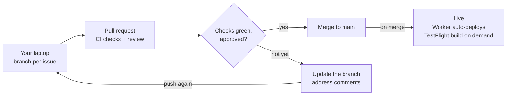
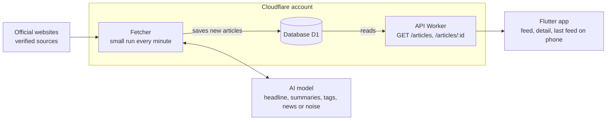

# Official News App — MVP Plan

Oct 11, 2026 · @Yurii

## The idea and MVP scope

A cross-platform app that shows what governments officially publish, summarized and translated by AI, newest first. Sources are only verified official websites of governments and international bodies, never media or trending lists.

**In the MVP**

- A feed of the latest official news, newest first, the same for everyone
- An article detail screen with the news-style AI summary, the ministry as publisher with an "Official source" mark, and a link to the official source
- Images on cards, taken from the official page's preview image
- News collected automatically from verified official sites, summarized once by AI
- A fast app: it opens instantly from the last feed saved on the phone

**Not in the MVP:** onboarding, picking topics and a topic-filtered feed, topic summaries, favorites, choosing a country and the Local / Global switch, the Countries tab, login and Sign in with Apple, country filter, search, push notifications, sharing to social networks and reposting, personalized feed, store release and Play upload (Android runs in the emulator until then). The data model is built so each of these can be added later without rework. After the MVP, a topic filter (one topic at a time) and a Where filter (all countries, a group of countries or one country) are being built (#67, #68; decision rows of 16 Oct).

## Agreed changes, 14 Oct 2026

After Roman's review (issues #3 to #11), these replace anything older further down where they differ.

- **Owners to start with, swaps as we go.** We start with the Work plan's owners (Yurii 2, 3, 5, 6; Roman 1, 4, 7, 8). Either of us can take over an item by agreeing in its issue first, then reassigning it. One person per issue at a time, so we never build the same thing. The Kickoff is done together.
- **The MVP is the feed and the article detail screen,** the same for every user, with images on cards (the official page's preview image) and the ministry shown as publisher with an "Official source" mark. Screen: the feed and article in [docs/design/app.png](design/app.png).
- **After the MVP (Phase 2 or later):** onboarding with topics and a topic-filtered "For you" feed; a full summary per topic, then topic analysis; choosing a country or a group of countries (the Where filter, #68); registration and Sign in with Apple; Saved (favourites); the Countries tab. Screens: [docs/design/onboarding.png](design/onboarding.png) and the rest of [docs/design/app.png](design/app.png).
- **Sources publish official decisions only:** laws, amendments, proposals, government and ministry meeting agendas, minutes and meeting outcomes. Opinion pieces, interviews, commentary, statements and call readouts are hidden (the AI's `isNews` flag).
- **The AI summary reads like news**, not two fixed blocks, facts from the article only. One AI call per article returns one news-style summary, the same for everyone, and tags the article with 1 to 3 topics from the fixed list, so the topic features have data when they come. Since #63 it also returns "what it means" (`impact`): for any reader, per topic of the article, for residents and for people abroad; the app personalizes by choosing the parts that fit the reader, never by writing a summary per reader (agreed, `docs/decisions.md`, 16 Oct).
- **The app looks and feels like Apple News** on iOS and Android, light and dark: large bold titles, red accent, serif headlines, publisher line above each headline, big images, iOS navigation and gestures. Each headline has a red decision-type label (Law, Bill, Cabinet decision…). Screens: [docs/design/mvp.png](design/mvp.png).
- **Countries:** G20 in the MVP, and from 16 Oct also Poland, Czechia, Spain and Ukraine, the countries of the translation languages (#72; brought forward from Phases 2 and 3). Labels for disputed territories wait until after the MVP.
- **Secrets:** no shared password vault. A key never travels between us: whoever creates it puts it straight into its one home. Yurii creates the keys that live in GitHub Secrets, the App Store Connect API key included (replaces Bitwarden, 14 Oct).
- **Google Play:** Yurii's account, Roman as Admin.

**Topic list (fixed, in the contract; the AI picks from it):** foreign-affairs, economy, security-defence, health, climate, trade, technology, energy, migration, elections, human-rights, science.

## Reviewing this plan (for Roman and his Claude)

Please reply with one short message, or as comments in this doc, covering these five points. No separate document is needed, and please don't rewrite the plan; suggest changes as comments.

This plan proposes approaches; it does not restrict how either of us, or our Claudes, build. A better solution is welcome as a comment, and once we agree, the plan changes.

1. **Accounts:** OK with the table in "Decide first", or what to change; plus Roman's GitHub username, Apple ID email and Google account email for the invites
2. **Split:** OK with Roman owning items 1, 4, 7 and 8, or which items to swap
3. **Clarity:** for each of items 1, 4, 7 and 8, either "clear" or the questions that must be answered before it can be built
4. **Open decisions:** a view on each item in "Open decisions"
5. **Kickoff:** two or three time slots for a 2-hour call

**Prompt for Roman's Claude:** "Read this plan as the developer of items 1, 4, 7 and 8. Reply with the five points in the 'Reviewing this plan' section. For point 3, list only what you could not build from the plan without asking."

## How to read this plan

The plan has three levels. Only the first is fixed; everything else is a starting point we can change together.

| Level | What it covers | Can it change? |
| --- | --- | --- |
| Fixed | Official sources only, never media or trending lists; GitHub flow with every pull request approved by the other person; the shared definitions (article format, API, database); one AI call per article for its summary, run once on the server and stored (an unusable answer is asked again, at most 3 tries in all); translations add one call per language (#46); the fetcher's small-runs rule | Only if we both agree, in a pull request |
| Must for the MVP | The "Done when" check of each of the 8 items: news comes in, gets summarized, and shows in the feed and the detail screen | The goal stays; how we reach it is up to the owner |
| Suggestion | Details such as Top today, the 7-day window, the "new updates" pill, dimmed read items, filters, layout and wording, cache times and other numbers | Yes. The owner decides; the app still works without them |

In the item details, each item lists what it must do and, separately, what is suggested.

**Easy to change later:** who owns an item (for example, the feed can move from Yurii to Roman), the order of work, any suggestion, and the number of sources. If one of us gets stuck on an item, the other can take it over: reassign the issue and continue from its branch. The shared definitions make this safe, because both sides already build to the same format.

**Hard to change later, so we decide them carefully now:**

- Which Apple and Google accounts host the app: moving an app between developer accounts is slow and needs Apple's and Google's transfer process
- The app's bundle ID and package name, which are permanent once the app is created
- Which Cloudflare account holds the backend and database
- The article format and database tables, once both the app and the backend depend on them and real data is stored
- Public repo: making it private later is one click; making a private repo public later means cleaning its history first, so it starts public

## Decide first: accounts and access

These are settled before any code, so neither of us ever waits for access. Agreed on our call, except Google Play, which is still open.

| Account | Created by | Invites | Role for the other person |
| --- | --- | --- | --- |
| Public GitHub repo `yuriityvodar-sudo/official-news`, no licence for now | Yurii | Roman | Admin |
| Cloudflare account (Worker + D1) | Yurii | Roman | Administrator |
| App Store Connect: the app and its TestFlight | Roman (his Apple Developer account) | Yurii | Admin, internal tester: Yurii can sign and upload builds and manage TestFlight on his own |
| Google Play Console: the app and internal testing | To decide: Yurii or Roman | The other person | Admin, internal tester |

**TestFlight from day one**

- The app and TestFlight are set up in the Kickoff, and the first build goes to TestFlight the same day, from Roman's Xcode
- Internal testers (us) need no Apple review; a build is installable once Apple finishes processing it. Beta App Review is only needed later, for external testers
- Builds are on demand: either of us runs the GitHub Actions upload workflow for any branch, and the build is in TestFlight about 15 minutes later. Approving or merging a pull request never produces a build by itself
- Every pull request still gets automatic checks (compile and tests); only the TestFlight upload is manual
- Build numbers come from the CI run number, so two uploads never clash
- The repo is public, so Actions minutes, macOS runners included, and branch protection with required reviews are free

**Also decided in the Kickoff:** the bundle ID and package name, which can never change. A neutral one not tied to either of us keeps options open; the app name people see can change at any time.

## Work plan: who builds what

**Agreed 14 Oct:** these are the starting owners. An item can move to the other person by agreeing in its issue first, then reassigning it; one person per issue at a time.

The MVP is a Kickoff plus 8 items, 4 each. This is our suggested split: Yurii owns how the news comes in and how the list looks; Roman owns the API, what the summary says and how the article detail looks.

| # | Item | Owner | Evenings | Done when |
| --- | --- | --- | --- | --- |
| 0 | Kickoff: repo, Cloudflare, TestFlight, first commit, shared definitions | Together | 2, one call | Both run the app and the backend locally and install it from TestFlight; `main` is protected |
| 1 | API on Cloudflare, pre-filled with 20 real articles | Roman | 3 | The deployed API returns the seed articles shown in the feed in the agreed format |
| 2 | Design of the feed and the article detail | Yurii | 2 | Designs approved by Roman in the issue |
| 3 | Feed screen | Yurii | 4 | The feed shows articles from the deployed API on both simulators |
| 4 | Article detail screen | Roman | 2 | Every article opens with its summary and source link |
| 5 | Source list: 20 official sites, one per G20 country | Yurii | 2 | 20 verified sources in the database |
| 6 | Fetcher: small run every minute, 1 source at a time | Yurii | 4 | All sources checked at least hourly, new articles saved without duplicates |
| 7 | AI summaries, noise filter and tags | Roman | 4 | New articles get all summary fields within an hour |
| 8 | Source health and cleanup of old texts | Roman | 2 | Each source shows its status; expired texts are cleared |
| 9 | Translations, after the MVP: Ukrainian, Russian, Spanish and German | Yurii | 3 | News in the feed gets its text in each language through a queue we can see and manage, and the API returns only translated articles with `lang` |

**After the MVP, towards the App Store release (agreed on the call, 16 Oct).** Each item is a GitHub issue assigned to its owner; the issue holds the details.

| Issue | Item | Owner | Done when |
| --- | --- | --- | --- |
| #63 | Better AI headlines and summaries (the prompt), backward compatible | Roman | Headlines and summaries are specific and only from the source; same fields plus a new `impact` field, "what it means" (English only for now), translations keep working, Groq quota respected |
| #56 | Article text layout (justified text, smaller body font, paragraphs) | Roman | Before/after agreed in the issue, then built |
| #64 | Settings screen from the top-right corner (language, notifications, privacy, terms, support, about, version); no login | Yurii (design and build) | Yurii approves it on the phone |
| #65 | Domain (Cloudflare Registrar) and app name | Yurii | Name decided, domain bought |
| #66 | Feed redesign: article cards, font, UI fixes | Yurii (design and build) | Yurii approves it on the phone |
| #67 | News categories: a Topics chip under the date, one topic at a time, busiest first, from the server, also for a country or a group | Yurii (design and build) | Server filters and `GET /topics` (Proposed, `docs/decisions.md`), then the app's chip; Yurii approves it on the phone |
| #68 | Where filter: all countries (default), a group of countries (European Union, G7, G20, NATO: its members' decisions together) or one country (that country's only) | Yurii (design and build) | Server filters (`country=`, `group=`) and `GET /countries` with its groups (Proposed, `docs/decisions.md`), then the app's chip; Yurii approves it on the phone |
| #60 | Analytics (Google Analytics through Firebase) | Yurii | Events arrive in GA from TestFlight; release checklist done |
| #62 | Push notifications, breaking decisions (importance 4+, max 2 a day) | Yurii | A breaking decision reaches a phone in its language |

**Order:** Kickoff first, then item 1 (it gives everyone real data from Cloudflare). Items 2, 5 and 7 start at the same time; 3 and 4 follow the design; 6 follows 5; 8 comes last.

**Milestones:** after item 7 the app works end to end with live, summarized official news. After item 8 the MVP is complete.

**Totals:** Yurii 12 evenings, Roman 11 (estimates; one evening is about 2 hours with Claude Code; expect up to 1.5× once CI signing and page extraction are counted).

## Shared definitions

Both of us, and both Claude Code setups, build against these. They are agreed in the Kickoff, committed to `docs/contract.md`, and changed only by agreement in a pull request.

**Repo layout**

```
official-news/
  app/                      Flutter app
    lib/core/               theme, router, models, API client, local cache
    lib/features/feed/      feed screen (item 3)
    lib/features/detail/    article detail screen (item 4)
  server/                   Cloudflare Worker (TypeScript)
    src/index.ts            fetch handler (API) + scheduled handler (every minute)
    src/api/                endpoints (item 1)
    src/fetcher/            source readers (item 6)
    src/summarizer/         AI step and prompt (item 7)
    src/health/             source status and cleanup (item 8)
    migrations/             D1 SQL: schema and the 20 seed articles
    eval/                   summary test set and results (item 7)
  docs/  contract.md  style-guide.md  sources.csv  source-names.csv  decisions.md
  CLAUDE.md  README.md  .github/workflows/
```

**Article format** (what the API returns and both screens read)

```json
{
  "id": "01JA2B3C4D5E6F7G8H9J",
  "country": "PL",
  "source": { "id": "pl-mfa", "name": "Ministry of Foreign Affairs", "url": "https://www.gov.pl/web/dyplomacja" },
  "publishedAt": "2026-10-11T14:05:00Z",
  "dateOnly": false,
  "headline": "Poland condemns attack on Riyadh airport",
  "shortSummary": "Poland condemned the attack, which killed 12 people and injured more than 300.",
  "summary": "Poland's foreign ministry condemned the 10 October attack on King Khalid International Airport in Riyadh… (news-style, 2 to 4 short paragraphs)",
  "decisionType": "decision",
  "imageUrl": "https://www.gov.pl/photo/… (or null)",
  "originalTitle": "Oświadczenie MSZ ws. ataku w Rijadzie",
  "originalLanguage": "pl",
  "topics": ["foreign-affairs", "security-defence"],
  "tags": ["Saudi Arabia", "Houthis", "aviation"],
  "importance": 4,
  "originalUrl": "https://www.gov.pl/web/dyplomacja/oswiadczenie-msz-ws-ataku-w-rijadzie"
}
```

The feed card reads `headline`, `shortSummary` and `imageUrl`; the detail screen reads `summary`. `topics` holds 1 to 3 values from the fixed topic list; the MVP app does not use it yet. Before item 7 is live, `headline` falls back to `originalTitle` and the summary fields are empty.

**API**

- `GET /articles?limit=20&cursor=<c>` → `{ "items": [Article], "nextCursor": "…" | null, "top": [Article] }`: news from the last 7 days where `is_news = 1`, newest first; `cursor` is an opaque string; `top` only on the first page (last 24 hours, highest importance, at most 2 per country, up to 5) and may be an empty array, so the app must not depend on it
- `GET /articles?since=<ISO time>` → only articles newer than that time, used for the "new updates" check
- `GET /articles/:id` → `Article`
- `GET /health` → sources per status, time of the last fetcher run, articles waiting for the AI and those it gave up on (#99)

**Database (D1)**

- `sources`: id, country, name, kind (`rss` | `page` | `api`), url, config (JSON: selectors for pages), language, verified\_by (`domain` | `portal` | `wikidata`), verified\_at, licence, status (`active` | `stale` | `moved` | `broken` | `blocked`), last\_checked\_at, last\_item\_at
- `articles`: id, source\_id, url (unique), original\_title, published\_at, date\_only, fetched\_at, text, text\_expires\_at, headline, short\_summary, summary, decision\_type, image\_url, original\_language, topics (JSON), tags (JSON), importance, is\_news, summarized\_at, model

**Fetcher rule (keeps us on the free plan)**

- The scheduled handler runs every minute and calls `fetcher.run()` then `summarizer.run({ maxArticles: 5 })`; the handler is committed in the Kickoff, and each owner changes only their own module. **Changed 15 Oct (#41):** the summarizer has its own cron trigger every odd minute, so the two never share one run's CPU
- The fetcher takes the source with the oldest `last_checked_at`, so every source is checked within the hour (up to 60 sources)
- One run shares one budget (one run per step since #41): on the free plan at most 50 outside requests and 10 ms of processing. The requests fit easily; the 10 ms is measured in item 6, and if text extraction needs more, the Worker moves to the paid plan (about $5 a month) and the small runs stay

**Speed rules (fast app, and about 10,000 daily users for free)**

- The phone keeps the last feed and opens from it instantly, then asks only `since` the newest article it has
- The list already carries the full summaries, so opening an article needs no extra call
- The API caches feed responses: Cloudflare's cache in front of the Worker (Workers Caching) keeps the lists for a minute and an article for 5 (#121)
- The "new updates" check runs every 5 minutes while the app is open

## Item details

Each item becomes one GitHub issue owned by one person. **Must** is what the item needs for the MVP to work; **Suggested** can be changed or dropped by the owner.

### 0. Kickoff (Yurii and Roman, one call)

- **Must:** set up the accounts in "Decide first" (public repo, no licence for now); first commit with the repo layout, `flutter create app`, the Worker in `server/`, `CLAUDE.md`, `README.md`, pinned Flutter version; `app/lib/core/` with the Article model from the contract, a minimal API client, the router with the feed and detail routes (the detail route receives the Article from the list) and the theme; `server/src/index.ts` with the API router and the scheduled handler calling `fetcher.run()` then `summarizer.run({ maxArticles: 5 })`, both as stubs; commit `docs/contract.md`, `migrations/0001_init.sql` and `migrations/0002_seed.sql` (20 real articles from the 11 Oct test feed with all summary fields filled, prepared by Yurii with Claude); CI checks for app and server on every pull request; an on-demand GitHub Actions workflow that uploads a TestFlight build from any branch; the first build sent to TestFlight from Roman's Xcode, and Roman creates the App Store Connect API key the upload workflow uses, stored as a GitHub Secret; this plan copied into docs/plan.md and a decision log started in docs/decisions.md; branch protection on.
- **Done when:** both of us run the app and `wrangler dev` locally, `main` is protected, and the first build installs from TestFlight on both our iPhones.

### 1. API on Cloudflare (Roman)

- **Must:** load the Kickoff seed migration into the local and deployed D1; `GET /articles` (7 days, newest first, 20 per page, cursor, `since`); `GET /articles/:id`; deploy from GitHub on merge to `main`.
- **Suggested:** `top` on the first page; 5-minute cache; `GET /health` (used by item 8).
- **Done when:** the deployed API returns the seed articles shown in the feed (3 of the 20 since the decisions-only rule) in the agreed format and tests pass in CI.

### 2. Design of the feed and the article detail (Yurii)

- **Must:** in the Apple News look set in the Kickoff (light and dark): feed card (decision-type label, country, source, time, headline, short summary, image) and the detail layout (headline, ministry as publisher with "Official source" mark, date, news-style summary, AI label, "Read the official source").
- **Suggested:** Top today, Today / Yesterday groups, "new updates" pill, dimmed read items, share button.
- **Done when:** the designs are linked in the issue and approved by Roman.

### 3. Feed screen (Yurii)

- **Must:** reads `API_URL` (passed with `--dart-define`); cards with images from `GET /articles`, scrolling for more; pull to refresh; loading, error and empty states.
- **Suggested:** the speed rules (saved last feed, `since` checks); Top today; day groups; "new updates" pill; dimmed read items; a cap per source per day or interleaving by country, so prolific sources do not flood the list.
- **Done when:** on the iOS Simulator and Android emulator the feed shows articles from the deployed API.

### 4. Article detail screen (Roman)

- **Must:** opens from a feed card using the Article already in the list; shows headline, the ministry as publisher with an "Official source" mark, date, image, the news-style summary, the AI label with original language, and "Read the official source"; shows the original title when no summary exists yet.
- **Suggested:** share button (the system share sheet); layout details beyond the approved design.
- **Done when:** every article from the API opens and its source link works on both simulators.

### 5. Source list (Yurii)

- **Must:** `docs/sources.csv` with one source per G20 member (19 since 14 Oct: Saudi Arabia waits for consent), plus Poland, Czechia, Spain and Ukraine (5 sources since 16 Oct, #72) and international organizations as sources of their own decisions (16 Oct: the European Central Bank, code `EU`; more international bodies follow: the ILO Governing Body once the app and website show a source's required notice on its articles, UN press and the African Union after the decision on #107), each with kind, URL, language, `verified_by` and licence, preferring pages that publish official decisions (laws, proposals, meeting agendas, minutes and outcomes), and each source's name in Ukrainian, Russian, Spanish and German in `docs/source-names.csv` (#76); loaded into `sources`.
- **Suggested:** grow to about 85 Phase 1 sources once the fetcher is stable.
- **Done when:** the verified sources are in D1 (19 since 14 Oct: Saudi Arabia waits for the gazette's written consent, see `docs/sources.md`).

### 6. Fetcher (Yurii)

- **Must:** `fetcher.run()`, called by the scheduled handler every minute, takes the source with the oldest `last_checked_at`; reads RSS/Atom feeds and news pages (selectors in `config`); skips URLs already stored; saves new articles with their extracted text and `text_expires_at`; clear User-Agent; respects `robots.txt`; logs requests and CPU time per run from the first version.
- **Suggested:** retries for failed sources; reading the site's own data endpoints.
- **Changed 16 Oct (#71):** the whole text, not the teaser. List text under 1,000 characters is completed from the item page or from the source's own data endpoint (`fullText` in `docs/sources.md`), within the same 2 page reads a run, reading at most 20,000 characters of a page; an item whose page fails or whose site is busy is asked again on later checks for up to 24 hours. PDF-only texts (South Africa, Brazil's bill text) are a later step.
- **Done when:** the deployed fetcher checks all 20 sources at least once an hour, new articles appear in D1 with no duplicates, and the logs show how close each run is to the free limits.

### 7. AI summaries (Roman)

- **Must:** `docs/style-guide.md` and the prompt; one call per article returning headline, shortSummary, summary (news-style, facts from the article only), decisionType (from the fixed list), topics (from the fixed list), tags, importance and isNews (an official decision, not opinion, interview or commentary); `summarizer.run()`, called by the scheduled handler every minute (every odd minute in its own run since #41), summarizes up to 5 articles that have text and no summary; anything that is not news is hidden from the feed.
- **Suggested:** a 25-article test set with `npm run eval`; comparing Workers AI and Claude Haiku and recording the choice and cost in `docs/decisions.md`.
- **Done when:** new articles get all summary fields within an hour of being fetched.

### 8. Source health and cleanup (Roman)

- **Must:** each source gets a status (active, stale, moved, broken, blocked) after every check; a daily job clears `text` once `text_expires_at` has passed and keeps the summary.
- **Suggested:** `GET /health` summary; a GitHub issue opened automatically for a broken source.
- **Done when:** a broken test source shows "broken", and a row with a past expiry loses its text but keeps its summary.

### 9. Translations, after the MVP (Yurii)

Agreed on #46 (15 Oct): a second AI call per article, one per language; the summarizer (item 7) stays as it is. Consistency first, speed second (Yurii): a post shows in a language only when it is fully and correctly translated, and the feed is the same in every language (release together, Yurii 15 Oct). Spanish goes through Groq; German is configured on Z.ai but off, since Z.ai blocks requests from Cloudflare Workers (`docs/decisions.md`).

- **Must:** `article_translations` (migration `0008`); a translator step on its own cron trigger (every even minute) that translates the headline, short summary and summary of news in the feed into Ukrainian, Russian, Spanish and German and stores which model wrote each one; the three fields checked and stored together, each in the language, with every number of the English in the translation; a re-summarized article translated again, the old translation served until then (or until the new English has used its 3 tries); providers per language in one constant (`TRANSLATORS`): Groq for Ukrainian (Qwen then GPT-OSS), Russian (GPT-OSS then Qwen) and Spanish (gpt-oss-20b then gpt-oss-120b), Z.ai for German (`glm-4.5-flash` then `glm-4.7-flash`, off for now), the Worker secrets `GROQ_API_KEY` and `ZAI_API_KEY`; `lang=uk|ru|es|de` on `GET /articles` (only translated articles, in the English order with the English `feedSeq`, cursors and `after=`; `translationsDelayed` while the language is paused) and `GET /articles/:id` (404 until released and translated).
- **Must, release together (Yurii, 15 Oct; migration `0010`):** the same feed in every language. A summarized decision is released (gets `feed_seq`) only when every enabled, not paused language has published it or failed it 3 times, and then appears in English and every language at once; the summarizer gives no `feed_seq`. A post that failed 3 times is absent from that language only. A language whose provider is down for more than 2 hours is paused automatically, still probed once a run, unpaused on its first answer, and catches up at the English places. While the translator is not running (no run for 10 minutes, as for about an hour after its trigger is added), the summarizer's run releases each decision at once (migration `0011`). Top stories per language are the English ones translated into it.
- **Must, the queue (Yurii: the centre of the design; migration `0009`, `docs/queue.md`):** an explicit state per article and language (`queued` → `translating` → `published`; `retrying` with `next_attempt_at` and a growing wait; `failed` after 3 unusable answers, with the reason; `updating` while a re-summarized article is redone, the old text visible; `skipped` when it left the feed), every change timestamped; nothing lost (every news article queued for every enabled language, stale claims back to `queued`, an outage never counts a try); a switch per language (enabled, paused by hand or automatically); `GET /queue` per language and the articles waiting for release; `server/scripts/queue.mjs` to list, requeue one item or a whole language, pause and resume, and enable a language with its 7-day backlog.
- **Suggested:** the app's language setting: a small language icon next to the date at the top of the feed opens a native language menu (a local iOS Simulator run shown to Yurii before it is built); an editor pass that corrects grammar and wording before publishing (#54); Polish and Czech once a model writes them well enough; Workers AI as a provider if the free limits are not enough.
- **Done when:** with the secrets set, new news articles get their text in each enabled language, `GET /articles?lang=uk` (or `ru`, `es`) lists the same articles in the same order as English, and `GET /queue` shows nothing waiting for long.

### 10. Push notifications, after the MVP (Yurii)

Yurii, 16 Oct (#62): pushes exist to bring a reader back to the app with something useful, so breaking decisions only, few, and none at night. Firebase Cloud Messaging in the project `official-news-48e16`, one topic per feed language; the rules are in `docs/contract.md` (Push notifications).

- **Must, server (#62):** the translator's run (the summarizer's, while the translator is not running) ends with a push step: a released decision of importance 4 or 5 from the last 24 hours, never pushed before in that language (another language only with its translation published, and in that language); at most 2 a local day per language and at least 1 (the day's top story from 18:00 local); none from 21:00 to 08:00 in the language's main time zone; 3 hours apart. `push_log` (migration `0012`) is written before each send, so nothing goes out twice. A push FCM cannot take just then is tried again after a 10-minute pause. Sent as the service account `fcm-sender` (one role, Firebase Cloud Messaging API Admin), its key only the Worker secret `FCM_SERVICE_ACCOUNT`.
- **Must, app:** subscribes to `breaking_<feed language>` and moves to the new topic when the language changes; asks for permission at a good moment (after a few articles read), not on first launch; a tap opens the article (`data.articleId` in `data.lang`); `push_open` in analytics. The APNs key uploaded to Firebase Cloud Messaging (`docs/setup.md`).
- **Before an App Store release:** the privacy policy and the App Store privacy answers mention the push token.
- **Done when:** with the secret and the APNs key set, a breaking decision reaches a test iPhone subscribed to its language's topic, and a tap opens it.

## How we work together

We use GitHub flow: one public GitHub repo, one long-lived branch (main), short-lived feature branches, every change through a reviewed pull request, and each task small enough to finish in one evening with a visible result.



Work happens on a branch on your own laptop; a pull request runs CI and gets the other person's review, and only a green, approved change merges to `main` and goes live.

When the team grows, or we need a staging version and versioned store releases, we can add release tags or a `develop` branch (Git flow). That is a change to repo settings, CI and `CLAUDE.md`, not to the code.

**Repo and reviews**

- One repo for the whole project: `/app` (Flutter) and `/server` (Cloudflare Worker)
- `main` is protected: no direct pushes, every pull request approved by the other person, small fixes included. The one exception is the first commit (README, CLAUDE.md, .gitignore, empty Flutter and Worker projects), pushed during Kickoff; protection is switched on right after, with no bypass for anyone
- One branch per issue: `feature/<issue#>-short-name` or `fix/<issue#>-short-name`
- Small pull requests, reviewed within a day: the reviewer's Claude Code leaves review comments on GitHub, the author's Claude Code works through them and flags anything that needs a decision, and the reviewer approves. Small means under about 500 changed lines of code (tests and docs aside); bigger work is split by screen or by step, each with a visible result
- Flow control (17 Oct): at most three open pull requests per person, so a review never waits behind six others; past that, the next piece waits as research, docs or a prototype until one merges. Merges go in batches when both are online, in an agreed order: merge one, update the next with `main`, re-approve, merge. The "branch must be up to date" rule stays; its cost only bites when many pull requests are open
- GitHub Actions builds and tests every pull request; a green check is required to merge, and branches must be up to date with \`main\`, so CI tests each change against the latest code

**Planning**

- Every feature and bug is a GitHub Issue with a "done when…" line and one owner
- Project board: To do → Ready → In progress → Review → Done
- Milestones group issues into phases

**Working principles**

- Each task is independent and ends with a visible result in the app
- The whole app runs on each laptop: Flutter in the Simulator, the Worker with `wrangler dev` and a local database
- The API comes first, pre-filled with 20 real articles, so app work uses real Cloudflare data from day two
- The Article data contract is agreed first and changed only by agreement

**Ownership**

- Each feature has an owner, who builds both its app and its Cloudflare parts
- The owner proposes the design in the issue, the other approves, the owner builds, the other reviews
- Later changes to a feature start as an issue; the owner builds them by default
- A `CODEOWNERS` file requests the owner's review automatically

**Bugs in each other's features**

1. Investigate freely on your own machine
2. Open an issue: steps to reproduce, expected vs actual, suspected cause, ideally a failing test
3. Small, clear fixes come as a pull request the owner reviews; larger ones go to the owner
4. Each person's branches are their own; comments go on the pull request

**Shared conventions**

- A `CLAUDE.md` in the repo holds structure, style, and how to build and test, so both Claude Code setups follow the same rules
- Pinned Flutter version (FVM) and similar Xcode versions on both Macs
- Secrets never enter the repo: keys live in GitHub Secrets and in local `.env` files shared privately; GitHub secret scanning and push protection are on, since the repo is public

**Documentation:** the repo is the single source of truth. From the Kickoff, this plan lives in `docs/plan.md` and every decision is recorded in `docs/decisions.md` with its date and reason. A pull request that changes a decision updates those files in the same pull request, so the other person approves the decision together with the code, and `CLAUDE.md` tells both Claudes to do this. Git history then shows who changed what, when and why. Decisions made on a call go into `docs/decisions.md` the same day.

**Notifications (both directions)**

- GitHub mobile app: review requests, comments, approvals and merges arrive as push notifications
- A shared Slack, Discord or Telegram channel with the GitHub integration posts every pull request event
- Either person can ask their Claude Code to read and work through the other's review comments

## Architecture and services

The app is Flutter; everything behind it runs on one Cloudflare account, with Workers AI or the Claude API for summaries.

| Service | Used for |
| --- | --- |
| Flutter | The iOS and Android app, one codebase |
| Cloudflare Workers | All backend code: fetching sources and the API the app calls |
| Cloudflare Cron Triggers | Runs the fetcher every minute, 1 source at a time |
| Cloudflare D1 | Database: sources, articles, summaries, tags |
| Cloudflare Browser Rendering | After the MVP: reading official sites whose news lists are built by JavaScript |
| Workers AI or Claude API (Haiku) | Summary, translation, tags and news-or-noise check, once per article |
| GitHub | Repo, issues, project board, Actions for CI and deploys |
| Apple Developer, Google Play Console | TestFlight, Play internal testing, store release |

**Accounts**

- A dedicated Cloudflare account for the app, created by Yurii, with Roman as Administrator; each person uses their own login
- A Cloudflare API token limited to this account, stored as a GitHub secret, so deploys run from GitHub on merge
- `account_id` pinned in the repo's wrangler config
- A Claude API key with a monthly spending limit, only if item 7 picks Claude
- Roman's Apple Developer account hosts the app and TestFlight, with Yurii added as Admin; the Google Play account is still to decide

**Alternatives considered:** Supabase (Postgres, Edge Functions, cron) and Firebase (Firestore, Cloud Functions). Cloudflare was chosen for one place for everything, a free tier that covers the MVP, and existing experience. Workers AI is compared against Claude in item 7.

## Costs and free capacity

The whole MVP fits Cloudflare's free plan; the first cost appears at about 10,000 daily users. Figures are estimates based on Cloudflare's [limits](https://developers.cloudflare.com/workers/platform/limits/), [D1](https://developers.cloudflare.com/d1/platform/pricing/) and [Workers AI](https://developers.cloudflare.com/workers-ai/platform/pricing/) pages, checked 11 Oct 2026.

| What | Free limit | Our use | Share |
| --- | --- | --- | --- |
| Worker requests | 100,000 a day | Fetcher: 1,440 runs a day | 1.5% |
| D1 rows read | 5 million a day | Fetcher: about 40,000 | under 1% |
| D1 rows written | 100,000 a day | Fetcher and AI: about 7,000 | about 7% |
| Workers AI | 10,000 Neurons a day | Phase 1: about 85–540 summaries a day fit, depending on the model | — |

**Daily users before any cost:** about 2,500 with a basic app (around 40 calls per user a day); about 10,000 with the speed rules (around 10 calls). The limit we reach first is Worker requests.

**After that:** Cloudflare's paid Workers plan, about $5 a month (price from memory), covers roughly 30,000 daily users. 100,000 daily users cost about $10–15 a month with the speed rules.

**AI:** depends on new articles, not users. Phase 1 is $0 on a small model, or about $2 a month on a stronger one. All 197 countries would be about $7–40 a month.

**Fixed fees we already pay:** Apple Developer $99 a year, Google Play $25 once.

**GitHub:** the repo is public, so Actions minutes (macOS runners included) and branch protection with required reviews are free. A private repo would need GitHub Pro for required reviews and would limit TestFlight builds to about 15 a month.

**Watching usage:** once a week, compare Workers requests, D1 reads and writes, and Workers AI Neurons in the Cloudflare dashboard with the table above. The fetcher logs how many requests and how much processing time each run used, so a run that comes close to the free limits shows up early.

## How news flows



Every minute the fetcher reads the next source on the list, so all sources are checked within the hour (up to 60 sources); it keeps only new items and sends each one to the AI model once. The app reads only from our API, 20 articles at a time.

## Feed and reading experience

The feed shows official news from the last 7 days, newest first, with a short "Top today" section on top. Nothing is ever pulled from trending or media sites.

**What counts as a new item**

- A link from a source that is not yet in the database (checked by normalized URL and title hash)

**What is shown**

- Only official decisions, as marked by the AI: laws, amendments, proposals, government and ministry meeting agendas, minutes and outcomes; opinion pieces, interviews, commentary, job adverts, tenders and routine notices are hidden
- The 7-day window is a query on publish date, not a stored list: it slides by itself, and nothing is deleted
- Loaded 20 items at a time as the user scrolls

**Order**

- **Top today:** 3–5 items from the last 24 hours with the highest AI importance score, at most 2 per country
- **Latest:** everything else, in the order it appeared in the feed, newest first (each card shows its official publication date), grouped under Today, Yesterday and so on by the day it appeared (decision 2026-10-15)
- Country chips filter the feed (after the MVP)
- At the end of the 7 days: "You're all caught up" (a "Show older" button can be added later)

**After reading**

- Items stay in the feed; opened items are shown dimmed
- New items never move the list while it is being read: a "N new updates" pill appears at the top, and pull to refresh brings them in

**Article detail screen**

- Plain-language headline written by the AI
- Country, source, publish date
- AI summary written as news, the same for everyone, labelled as AI and showing the original language
- "Read the official source" button
- Share button

**Favorites** move to Phase 2.

## AI summaries

The summary is the product: one AI call per article for its summary, run once on the server and stored (an unusable answer is asked again, at most 3 tries in all); translations add one call per language (#46). Never on the phone.

**What each call returns**

- Plain-language headline
- A short summary for the feed and a news-style summary for the detail screen, in English
- Translation note (original language)
- Category, topics, people and organisations mentioned, country
- Importance score 1–5
- News or noise

**Rules for the model** live in a versioned style guide in the repo: facts only from the article, numbers copied exactly, no speculation, short sentences.

**How quality is tested**

1. A fixed set of 20–30 real articles across countries and languages
2. The same style guide run through each candidate model (Workers AI models and Claude Haiku)
3. Scored on correct facts and numbers, no invented information, translation, readability, usefulness of "Why it matters"
4. Both of us read them side by side; Claude pre-scores against the style guide
5. The set is re-run on every prompt or model change

The test also gives the real cost per article, which decides the model.

**Depth of analysis, in levels**

| Level | What it says | Grounded in | When |
| --- | --- | --- | --- |
| 1. Facts | What happened, who is affected, what changes and when | The article only | MVP, every article |
| 2. Context | Related earlier announcements; what other governments said | Our own archive of official sources | After MVP |
| 3. Impact | Measured effects and expert analysis, with citations, labelled "Analysis" | External sources via AI with web search | Later, top \~5 stories a day |

## Data, retention and personalization

The feed shows 7 days; the database keeps every article record permanently, so search, history and personalization can be built on it later.

| Data | Kept for | Why |
| --- | --- | --- |
| Feed visibility | 7 days | Product choice; one number in the query |
| Article record: headline, summary, tags, link, dates | Permanently | Archive, search, personalization |
| Full extracted text of the official page | 30–90 days, or permanently where the licence allows | Only used to regenerate summaries |

Estimate, to be measured in discovery: about 200 articles a day at about 3 KB per record is roughly 200 MB a year.

**Legal position:** users see only our summary, the source name and a link; full text is stored privately for processing. US federal content is public domain, UK content is mostly under the Open Government Licence, and many EU countries exclude official documents from copyright. Each source records its licence; a legal review of the source list comes before any commercial launch. The fetcher respects `robots.txt`.

**Built in from the MVP**

- Rich tags on every article: topics, entities, category, country, importance (item 7)
- Stable article IDs that are never reused (Article contract)
- Licence per source and text expiry (items 5, 6 and 8)

In Phase 2 the app adds on-device events (opened, read time, saved) and a "Not interested" option on cards.

**Later:** a "For you" feed ranked by tags, similar articles (Cloudflare Vectorize), a weekly digest, labels on favorites, profiles with synced history.

## Sources: validation and health

Every source is verified as official before it goes live, and its health is checked automatically on every run.

**Verification (one is required, recorded with date)**

1. Government-reserved domain: `gov.pl`, `go.ke`, `gov.il`, `admin.ch`, `europa.eu`
2. Linked from the country's main government portal (covers sites like `regjeringen.no`, `government.nl`)
3. Listed as the official website on Wikidata for that ministry or body

State news agencies count only when the government portal links them, and are labelled "state agency".

**Per source, about 4 to start:** head of state or government, foreign ministry, finance ministry, central bank.

The MVP starts with 20 sources, one per G20 country, chosen from those that read cleanly in the 11 Oct test; Phase 1 then grows to about 85.

**Health status, set automatically**

| Status | Detected by |
| --- | --- |
| Active | New items at the source's usual pace |
| Stale | Nothing new for much longer than its usual pace |
| Moved | The site redirects to a new address |
| Broken | Errors, or zero items parsed |
| Blocked | The site refuses automated access |

A content check pauses a source whose pages stop looking like official news (for example an expired domain taken over).

**Reading methods, tried in order:** RSS or Atom feed → news page → the site's own data endpoint → browser rendering for JavaScript-built pages → another verified official source from the same country. PDF and Word releases are read as documents. Bot checks and CAPTCHAs are never bypassed; for blocked sites we contact the press office and ask to allow our clearly named fetcher.

**Keeping the list current**

- A monthly job compares each country's government portal (its ministries) against our list and proposes changes: renamed ministries, new governments, new websites
- Proposals arrive as GitHub issues; one of us approves before anything goes live

## Country rollout

Four phases cover all 197 countries and territories, starting with the G20; each phase is about 4 official sources per country.

| Phase | Scope | Count | Sources (approx.) |
| --- | --- | --- | --- |
| 1 | G20 | 19 countries + EU + African Union | 85 |
| 2 | Hotspots, regional powers, international bodies | 25 + 7 bodies | 110 |
| 3 | Regional completeness | 52 | 210 |
| 4 | All remaining countries | 101 | 300 |

**Phase 1: G20**

- Asia: China, India, Japan, South Korea, Indonesia
- Middle East: Saudi Arabia, Turkey
- Europe: United Kingdom, Germany, France, Italy, Russia
- Americas: United States, Canada, Mexico, Brazil, Argentina
- Africa and Oceania: South Africa, Australia
- Blocs: European Union, African Union

**Phase 2: hotspots, regional powers, international bodies**

- Europe: Ukraine, Poland, Spain, Netherlands, Switzerland, Norway, Sweden
- Middle East: Israel, Palestine, Iran, Iraq, United Arab Emirates, Qatar
- Asia: Taiwan, Pakistan, Bangladesh, Vietnam, Thailand, Philippines, Malaysia, Singapore
- Africa: Egypt, Nigeria, Kenya, Ethiopia
- International bodies: UN, WHO, IMF, World Bank, NATO, WTO, OPEC

**Phase 3: regional completeness**

- Europe (23): Austria, Belgium, Bulgaria, Croatia, Cyprus, Czechia, Denmark, Estonia, Finland, Greece, Hungary, Iceland, Ireland, Latvia, Lithuania, Luxembourg, Malta, Portugal, Romania, Slovakia, Slovenia, Serbia, Belarus
- Middle East (7): Kuwait, Oman, Bahrain, Jordan, Lebanon, Syria, Yemen
- Asia-Pacific (6): New Zealand, Kazakhstan, Uzbekistan, Sri Lanka, Myanmar, Afghanistan
- Africa (10): Algeria, Morocco, Ghana, Tanzania, Angola, DR Congo, Côte d'Ivoire, Uganda, Senegal, Sudan
- Americas (6): Chile, Colombia, Peru, Venezuela, Ecuador, Cuba

**Phase 4: all remaining countries**

- Africa (39): Benin, Botswana, Burkina Faso, Burundi, Cabo Verde, Cameroon, Central African Republic, Chad, Comoros, Republic of the Congo, Djibouti, Equatorial Guinea, Eritrea, Eswatini, Gabon, Gambia, Guinea, Guinea-Bissau, Lesotho, Liberia, Libya, Madagascar, Malawi, Mali, Mauritania, Mauritius, Mozambique, Namibia, Niger, Rwanda, São Tomé and Príncipe, Seychelles, Sierra Leone, Somalia, South Sudan, Togo, Tunisia, Zambia, Zimbabwe
- Americas (24): Antigua and Barbuda, Bahamas, Barbados, Belize, Bolivia, Costa Rica, Dominica, Dominican Republic, El Salvador, Grenada, Guatemala, Guyana, Haiti, Honduras, Jamaica, Nicaragua, Panama, Paraguay, Saint Kitts and Nevis, Saint Lucia, Saint Vincent and the Grenadines, Suriname, Trinidad and Tobago, Uruguay
- Europe (14): Albania, Andorra, Armenia, Azerbaijan, Bosnia and Herzegovina, Georgia, Kosovo, Liechtenstein, Moldova, Monaco, Montenegro, North Macedonia, San Marino, Vatican City
- Asia (12): Bhutan, Brunei, Cambodia, North Korea, Kyrgyzstan, Laos, Maldives, Mongolia, Nepal, Tajikistan, Timor-Leste, Turkmenistan
- Oceania (12): Fiji, Kiribati, Marshall Islands, Micronesia, Nauru, Palau, Papua New Guinea, Samoa, Solomon Islands, Tonga, Tuvalu, Vanuatu

Phases 1 and 2 cover about 12 languages, so translation quality matters from the start. Labels for territories with disputed status are an open decision.

## Discovery findings: live source test, 11 Oct 2026

We read the latest official news (4–11 Oct) from all Phase 2 sources and the Phase 1 European sources. Every country had real news in the window, but only part of it can be read with a simple feed reader.

| Group | Read cleanly | Needed a browser or the site's own data endpoint | Blocked or down |
| --- | --- | --- | --- |
| Phase 1 Europe + EU | gov.uk Atom feeds, Bundesregierung RSS, governo.it RSS, European Commission API, ECB, Bank of England | Auswärtiges Amt, diplomatie.gouv.fr, economie.gouv.fr | German finance ministry, French government portal, Council article pages (its feed works) |
| Phase 2 Europe | Swiss federal news feed, gov.pl ministries, Spanish ministries, Riksbank, Norges Bank | Ukrainian presidency and foreign ministry, Dutch government, Norwegian Royal House | Norwegian government, Polish presidency, Ukrainian cabinet and finance ministry, Polish and Dutch central banks |
| Phase 2 Middle East | UAE and Qatar foreign ministries, Iraqi PM, Iranian presidency | Israeli presidency | gov.il, Palestinian presidency, Iranian and Iraqi foreign ministries, UAE central bank |
| Phase 2 Asia | Vietnam government portal, Taiwan presidency, Singapore PMO and MFA, Thai MFA, Philippine finance RSS | Bangladesh MFA, Bank of Thailand | Thai government, Philippine PCO and DFA, Bangladesh Bank, Philippine central bank |
| Phase 2 Africa, UN, WHO | Nigeria State House RSS, Kenya MFA and central bank RSS, Egypt SIS, UN News | Ethiopian PMO, WHO (via its own data endpoint) | Egyptian presidency |
| International bodies | WTO RSS | World Bank, NATO, IMF article pages | OPEC lists, IMF feed |

**What this means for the build**

1. **RSS covers a minority of sources.** No feed was found for any Middle East source. The fetcher needs page reading and site data endpoints from the start; MVP launches with the sources that read cleanly, and the rest follow after the MVP.
2. **Some official sites block automated reading** (Cloudflare, Radware, Imperva checks). Each one needs an alternative official source from the same country, or a request to its press office.
3. **Official feeds go quiet.** Kenya's presidency feed has had nothing since August, Ethiopia's foreign ministry since June, WHO's English RSS since February. The health check must flag these.
4. **The noise filter matters.** Feeds mix news with birthday greetings, tributes, campaign statements, bond auctions and tenders.
5. **Some releases are documents.** Malaysia's foreign ministry posts PDFs; Bangladesh's daily handouts are Word files.
6. **Native-language feeds are fuller.** Iran's Persian site and Switzerland's German feed carry more and newer items than their English versions, so we read the native feed and translate.
7. **Many dates have no time.** Order within a day is approximate unless the source gives a timestamp; we store our own fetch time too.
8. **The same event is covered by many governments.** The 10 Oct attack on Riyadh airport drew statements from Egypt, Poland, Spain, France, Italy, Malaysia, Singapore, the UAE, Qatar and the UN Secretary-General; the US sanctions on the ICC drew statements from Spain, the UK, Germany, France, Italy and the EU. Grouping these is the "what other governments said" feature (analysis level 2), and it shows up in real data on day one.

**Rest of Phase 1 (Americas, Asia, Russia, Türkiye, Saudi Arabia, South Africa, Australia, African Union)**

- Read cleanly: White House, State Department, Federal Reserve, Canadian PM and canada.ca feeds, Kremlin and Russian government RSS, Türkiye MFA RSS, South African Presidency RSS, Australian Treasurer feed, gov.cn, PIB (India), Japan MOF and Bank of Japan RSS, korea.kr, Indonesia's State Secretariat
- Needed a browser: gob.mx and gov.br (bot checks for simple fetchers), Saudi Press Agency, Japan MOFA, India MEA, Korean presidency and foreign ministry
- Blocked or down: Russian MFA (CAPTCHA), Indonesian presidency (Cloudflare), South African foreign ministry (site error)
- English pages lag native ones in Japan, Korea and Indonesia; Korea's finance ministry has a new name and domain, which the source health check must catch

## Open decisions

- [ ] Google Play: Yurii's account or Roman's (GitHub and Cloudflare by Yurii, App Store Connect and TestFlight by Roman: agreed on our call)
- [ ] Confirm the split in the Work plan
- [ ] Secrets: confirm the five rules. Nothing secret in the repo (secret scanning and push protection on); each secret has one home (CI keys in GitHub Secrets, runtime keys as Cloudflare Worker secrets, local keys in .dev.vars or .env); Cloudflare, GitHub and Apple are each person's own login, and Workers AI and D1 need no key; the two shared keys (Claude API if chosen, App Store Connect upload) go through a shared password-manager vault, never chat; every key has a spending limit and a leaked key is rotated at once
- [x] AI model: Workers AI, `@cf/google/gemma-4-26b-a4b-it` (item 7, 14 Oct; Gemma 4 since #63, 16 Oct; see `docs/decisions.md`)
- [ ] Home countries in Phase 1: move Kenya, and Roman's country, up from Phase 2?
- [ ] Labels for territories with disputed status (Taiwan, Palestine, Kosovo)
- [ ] Later: app name
